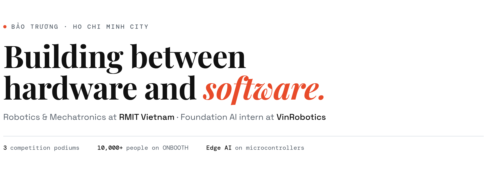

<picture>
  <source media="(prefers-color-scheme: dark)" srcset="assets/hero-dark.png">
  
</picture>

I like the part where code meets something physical: firmware and edge AI on microcontrollers, the mechanisms they drive, and the apps people actually use to talk to them. On team projects I'm usually the hardware/software architect; on my own I ship products end to end. Off the clock, I'm on the basketball court.

<a href="https://baotrq.github.io/Personal-Portfolio/"><picture><source media="(prefers-color-scheme: dark)" srcset="assets/btn-portfolio-dark.png"></picture></a>&nbsp;<a href="https://www.onboothvn.com"><picture><source media="(prefers-color-scheme: dark)" srcset="assets/btn-onbooth-dark.png"></picture></a>&nbsp;<a href="mailto:tdmbao2005@gmail.com"><picture><source media="(prefers-color-scheme: dark)" srcset="assets/btn-email-dark.png"></picture></a>

 

<picture>
  <source media="(prefers-color-scheme: dark)" srcset="assets/label-selected-work-dark.png">
  
</picture>

<table>
<tr>
<td width="48%"></td>
<td>

### [Roll](https://github.com/baotrq/roll-showcase)
**Money habits, with a cat.**

An expense tracker where logging takes seconds: snap a photo, say it out loud, or let a bank notification fill it in. Offline-first, with a Wear OS companion and a native iOS port.

Kotlin · Compose · SwiftUI · Supabase · Gemini 
Store-ready in six weeks, solo

</td>
</tr>
<tr>
<td>

### [ONBOOTH](https://github.com/baotrq/onbooth-showcase)
**Far apart, same strip.**

A photobooth for friends in different places: up to eight people on live video, one synced countdown, one shared strip, composited in every browser with no server touching an image.

Next.js · WebRTC · MediaPipe · Redis 
<b>10,367 users</b> · live at <a href="https://www.onboothvn.com">onboothvn.com</a>

</td>
<td width="48%"></td>
</tr>
</table>

 

<picture>
  <source media="(prefers-color-scheme: dark)" srcset="assets/label-competitions-dark.png">
  
</picture>

<table>
<tr>
<td width="48%"></td>
<td>

### [P.I.L.L.A.R.S](https://github.com/baotrq/pillars-showcase)
**🏆 First Runner-Up · FPT IoT Challenge 2026**

AIoT homecare for Parkinson's: a wristband that flags a fall or freeze on-device, and a home Station that hands the right pills to the right person. I built the dispenser and the kiosk.

EFR32xG26 · TFLite Micro · ESP32 · Raspberry Pi

</td>
</tr>
<tr>
<td>

### [S.C.E.N.T](https://github.com/baotrq/scent-showcase)
**🏆 Second Prize · FPT IoT Challenge 2025**

A perfume shelf that recommends a fragrance, tracks stock and hears a bottle break. I built the recommendation model: a 64-D embedding, full INT8 on an EFR32xG24.

EFR32xG24 · Silicon Labs MLTK · OpenThread

</td>
<td width="48%"></td>
</tr>
<tr>
<td width="48%"></td>
<td>

### [Ecyce MediLink](https://github.com/baotrq/ecyce-showcase)
**🏆 First Runner-Up · NEO League Season 2**

A pill dispenser that recognises who's in front of it, reads a paper prescription, and drops one pill at a time. I built the dashboard and app flow.

ESP32 · MQTT · ArcFace · Tesseract OCR

</td>
</tr>
</table>

 

<picture>
  <source media="(prefers-color-scheme: dark)" srcset="assets/label-more-builds-dark.png">
  
</picture>

<table>
<tr>
<td width="33%" valign="top"> <b><a href="https://github.com/baotrq/egg-gripper-showcase">Egg Gripper</a></b> Lifts a raw egg without breaking it. 97/100 on the demo.</td>
<td width="33%" valign="top"> <b><a href="https://github.com/baotrq/simpmusic-bao-showcase">SimpMusic (Bao)</a></b> A car LED strip that follows the album art, over reverse-engineered BLE.</td>
<td width="33%" valign="top"> <b><a href="https://github.com/baotrq/age-in-motion-showcase">Age in Motion</a></b> Your age, counting up live on the home screen.</td>
</tr>
</table>
